# Shipit Weekend — Docker → GHCR → GitHub Actions → Azure Container Apps


> **Project outcome:** Containerize a lightweight Python web application, publish it to GitHub Container Registry (GHCR), host it on Azure Container Apps, and automate subsequent image builds and deployments on every push to `main`.
>
> **Outcome verified on October 30, 2026:** The public endpoint displayed the updated heading **“Shipped automatically by GitHub Actions!”**, replacing **“Hello from Shipit Weekend!”** after a GitHub push and CI/CD troubleshooting. This is a practical end-to-end deployment demonstration, **not** a claim that the application is production-hardened.

**Repository:** [github.com/forsythfamous/shipit-app](https://github.com/forsythfamous/shipit-app)  
**Deployed application:** [shipit-app.mangohill-66b09a85.polandcentral.azurecontainerapps.io](https://shipit-app.mangohill-66b09a85.polandcentral.azurecontainerapps.io/)  
**Registry image:** `ghcr.io/forsythfamous/shipit-app:v1` (initial manually published version); subsequent workflow images are tagged with the short Git commit SHA.  
**Deployment region:** `polandcentral`  
**Resource group:** `shipit-rg`  
**Container app:** `shipit-app`  
**Application/container target port:** `8080`

## Contents

1. [Goal and success criteria](#1-goal-and-success-criteria)
2. [Architecture and deployment flow](#2-architecture-and-deployment-flow)
3. [Technology stack and resources](#3-technology-stack-and-resources)
4. [Prerequisites](#4-prerequisites)
5. [Local Docker workflow](#5-local-docker-workflow)
6. [Publishing to GitHub Container Registry](#6-publishing-to-github-container-registry)
7. [Provisioning Azure Container Apps](#7-provisioning-azure-container-apps)
8. [GitHub Actions CI/CD workflow](#8-github-actions-cicd-workflow)
9. [Azure authentication and GitHub secrets](#9-azure-authentication-and-github-secrets)
10. [End-to-end verification](#10-end-to-end-verification)
11. [Troubleshooting diary: every issue encountered](#11-troubleshooting-diary-every-issue-encountered)
12. [Key technical lessons](#12-key-technical-lessons)
13. [Security, operations, and cost controls](#13-security-operations-and-cost-controls)
14. [Improvements and next steps](#14-improvements-and-next-steps)
15. [Screenshot evidence](#15-screenshot-evidence)
16. [Useful command reference](#16-useful-command-reference)

---

## 1. Goal and success criteria

The goal of **Shipit Weekend** was to demonstrate a simple but realistic cloud delivery process, starting from application source code and ending with a public cloud deployment that updates automatically.

### Objectives

- Package a Python application in a Docker image.
- Run and troubleshoot the container locally on Ubuntu.
- Publish a versioned image to the private GitHub Container Registry.
- Create an Azure resource group and Azure Container Apps environment.
- Expose the application through Azure Container Apps external HTTPS ingress.
- Create a GitHub Actions workflow that, on a push to `main`, builds and pushes a new image and updates Azure Container Apps.
- Demonstrate automation by changing the application's heading and observing that new content on the live website.
- Diagnose the real-world problems encountered: ports, Docker contexts, registry authorization, Azure region restrictions, GitHub Actions package permissions, and Azure login secrets.

### Verification criteria

| Criterion | Evidence | Result |
| --- | --- | --- |
| Docker can build application image | Local `docker build` output | ✅ |
| GHCR can accept the image | `docker push` completed with manifest digest | ✅ |
| Azure can host the application | `az containerapp up` reported deployment success | ✅ |
| Public HTTPS endpoint responds | Browser showed original HTML | ✅ |
| Workflow is triggered by a Git push | GitHub Actions run appears after commit | ✅ |
| Workflow can deploy an updated application | Live HTML heading changed after fixing pipeline | ✅ |
| OIDC, automated tests, observability hardening | Future improvements | Not in scope |

## 2. Architecture and deployment flow

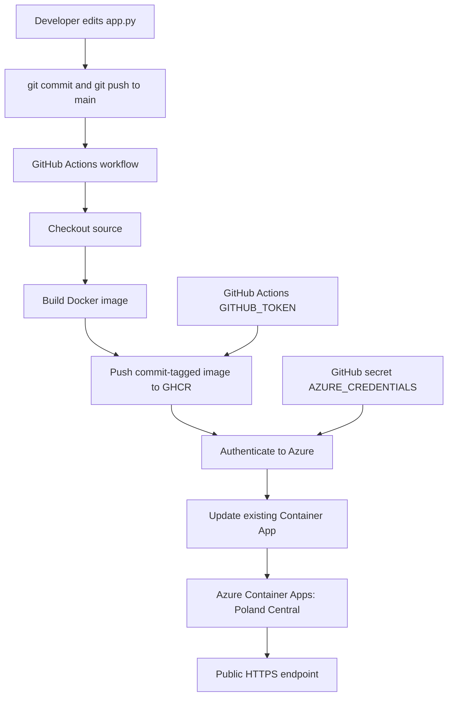

**Two distinct workflows were used:**

1. **Initial setup (manual):** Build locally → authenticate to GHCR → push `:v1` → provision the app in Azure.
2. **Continuous deployment:** Push a source change → GitHub Actions builds and publishes a newly tagged image → Azure Container App updates to that image.

The first proves the infrastructure works; the second proves the delivery process is automated.

### Azure resource layout

```text
Azure subscription
└── Resource group: shipit-rg (Poland Central)
    ├── Container Apps managed environment: shipit-app-env
    ├── Container App: shipit-app
    │   ├── External HTTPS ingress
    │   ├── Target container port: 8080
    │   └── Container image sourced from GHCR
    └── Log Analytics workspace (automatically created by az containerapp up)
```

The resource group was initially in **West Europe**. That deployment failed because Azure refused creation of a new Log Analytics workspace for the selected region/subscription. The empty group was removed and recreated in **Poland Central**; the environment and app then deployed successfully. The group itself is a management boundary, not a requirement that every resource share its location, but aligning the locations was the chosen design for this lab.

## 3. Technology stack and resources

| Layer | Tool/service | Role |
| --- | --- | --- |
| Application | Python (`app.py`) | Tiny HTTP response rendered in a browser |
| Packaging | Docker, Dockerfile | Build and run a portable container image |
| Workstation | Ubuntu / VS Code | Editing, Git, Docker CLI, Azure CLI |
| Source control | Git + GitHub | Version control and trigger for deployments |
| Registry | GitHub Container Registry (`ghcr.io`) | Private versioned container images |
| Automation | GitHub Actions | Image build, push, and Azure deployment |
| Identity | GitHub `GITHUB_TOKEN`; Azure service principal | CI registry and cloud authentication |
| Hosting | Azure Container Apps | Managed container hosting and external ingress |
| Monitoring | Azure Log Analytics | Workspace created during deployment |

**Naming used in this lab:**

```text
GitHub repository:  forsythfamous/shipit-app
GHCR:               ghcr.io/forsythfamous/shipit-app
Azure RG:           shipit-rg
Azure environment:  shipit-app-env
Azure ContainerApp: shipit-app
Region:             polandcentral
App port:           8080
```

The workflow and a change to `app.py` are visible in the session screenshots. This README documents the observed process; it does **not** reconstruct the exact full original `app.py` or Dockerfile contents where they were not supplied.

## 4. Prerequisites

- Ubuntu/Linux terminal and VS Code (or equivalent).
- Docker Engine/Desktop and Docker CLI.
- A GitHub repository with permission to run Actions.
- Azure CLI: `az --version` and `az login`.
- Azure subscription with appropriate permissions to create resource groups, Container Apps, managed environments, monitoring resources, and (for the workflow identity) service principals and role assignments.
- A **classic GitHub personal access token** with `write:packages` to manually push a private image to GHCR; this was used for the initial local publish, **not** committed to source control.
- A working `Dockerfile` and `app.py` in the repository root.

> **Safety:** Never commit personal access tokens, Azure client secrets, or command outputs containing credentials. The sample JSON and commands below contain placeholders only.

## 5. Local Docker workflow

### Build a local image

```bash
docker build -t shipit-app:latest .
```

Check available images:

```bash
docker images | grep shipit
```

### Run it locally

```bash
docker run -d --rm \
  --name shipit \
  -p 8080:8080 \
  shipit-app:latest

curl -i http://localhost:8080/
```

`-p HOST_PORT:CONTAINER_PORT` makes a process listening on port 8080 inside the container available at host port 8080. `--rm` removes the container when it stops; `--name` sets a predictable name.

If host port 8080 is busy, you can instead use:

```bash
docker run -d --rm --name shipit -p 8081:8080 shipit-app:latest
curl -i http://localhost:8081/
```

**This lab's port conflict had a more interesting cause:** an existing WordPress container held host port 8080 in a **different Docker daemon**, described in the troubleshooting diary.

### Docker contexts matter

```bash
docker context ls
docker context show
docker ps -a
sudo docker ps -a
```

On this workstation, the normal `docker` CLI targeted Docker Desktop (`desktop-linux`), while `sudo docker` talked to the system Docker Engine. This explained why `docker ps` appeared empty while `docker-proxy` occupied 8080. It also explained why an image built in one daemon could be missing from the other.

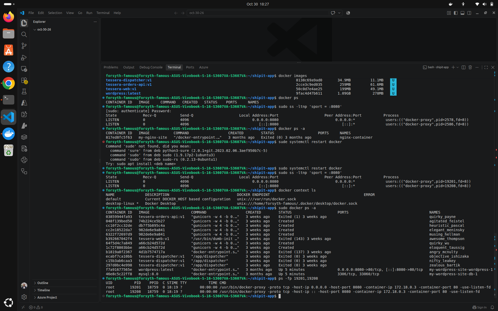

### Identify a conflicting host port

```bash
sudo ss -ltnp 'sport = :8080'
docker ps
sudo docker ps -a
```

The `ss` output showed `docker-proxy` listening on port 8080. The system Docker daemon exposed `my-wordpress-site-wordpress-1` on `0.0.0.0:8080->80/tcp`. It had restarted after Docker Engine was restarted, so restarting Docker did **not** free the port.

For this session, the WordPress application was intentionally stopped:

```bash
sudo docker stop my-wordpress-site-wordpress-1
sudo ss -ltnp 'sport = :8080'
```

> **Caution:** Stopping or restarting an unrelated container can interrupt its users. Using a different host port, such as 8081, is normally the safer first alternative.

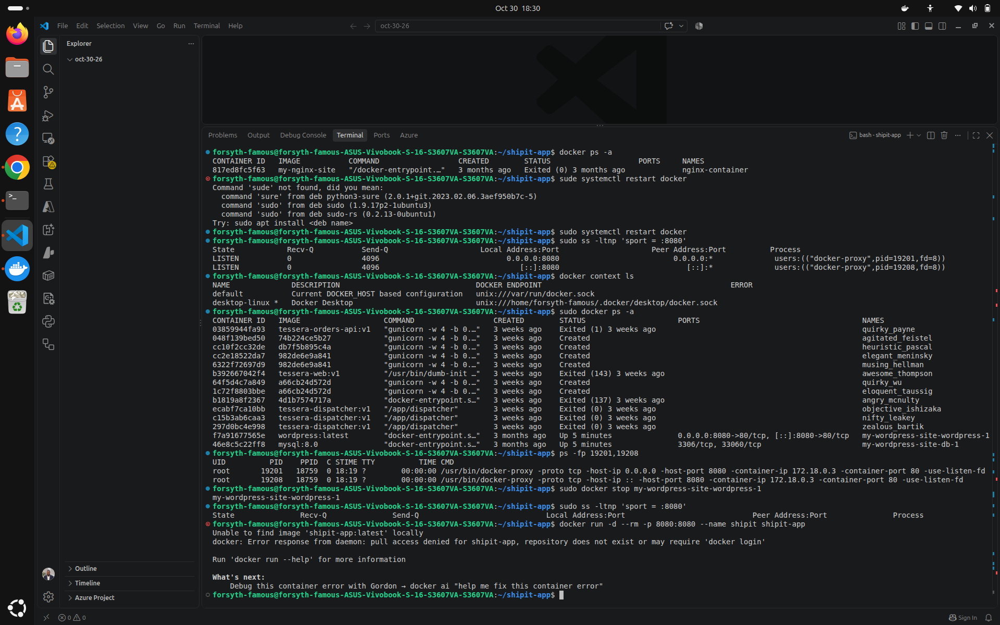

After releasing the port, a `docker run` attempt failed with `pull access denied for shipit-app`: the selected Docker daemon could not find that local image. The remedy is to inspect the active context and build, retag, or pull the image **in that same daemon**. A Docker image is not automatically synchronized across Desktop and Engine.

## 6. Publishing to GitHub Container Registry

### Authenticate for a manual push

```bash
docker login ghcr.io -u forsythfamous
```

Use the **classic GitHub token** at the password prompt. For automation, prefer `--password-stdin` to avoid placing a credential on a command line.

### Build with a GHCR tag

```bash
docker build -t ghcr.io/forsythfamous/shipit-app:v1 .
```

The build completed successfully in this lab (Python 3.12 slim appeared as the base image in build output).

### Push the image

```bash
docker push ghcr.io/forsythfamous/shipit-app:v1
```

**What happened:**

1. The first upload progressed through image layers but failed with `net/http: timeout awaiting response headers` during a layer commit.
2. A retry showed `Layer already exists` on many layers, but ended with `error from registry: denied`.
3. The classic PAT already had `write:packages`; the package was private, and the GitHub account had **Admin** access. Privacy alone was not the cause.
4. A later retry completed and printed the final manifest digest. The exact reason the intermittent GHCR failure cleared was **not conclusively isolated**, so it should not be described as definitely a token-scope fix.

Successful output included:

```text
v1: digest: sha256:9a7aac33c5b1a2ce53f8dfecfc878b9a36672c4743cced3acc80bc6136754314 size: 856
```

**The digest is the decisive success signal.** `Layer already exists` means individual blobs are present; it does **not** prove the manifest was published.

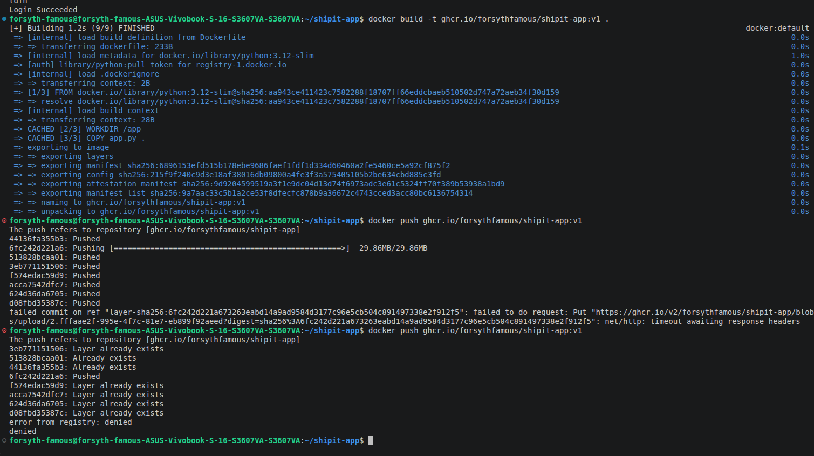
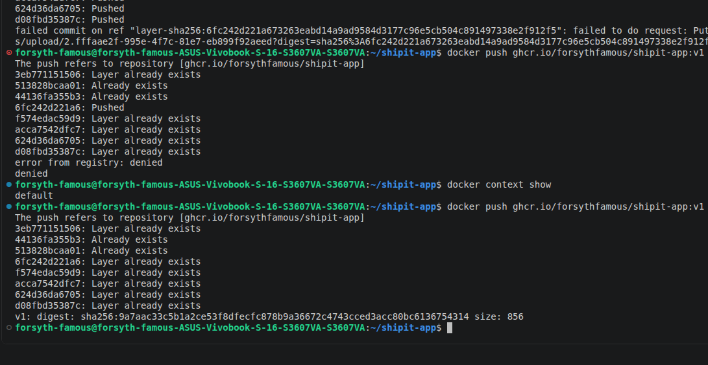

GHCR package access has two separate concepts:

- **Visibility:** private/public — who may view or pull the package.
- **Permissions:** who or which repository can read/write/administer the package. In particular, a manually published package may need an explicit **Manage Actions access** grant to let a GitHub Actions repository push later versions via `GITHUB_TOKEN`.

## 7. Provisioning Azure Container Apps

### Register the Azure resource providers

```bash
az provider register --namespace Microsoft.App --wait
az provider register --namespace Microsoft.OperationalInsights --wait
```

### Original attempt: West Europe

```bash
az group create --name shipit-rg --location westeurope

az containerapp up \
  --name shipit-app \
  --resource-group shipit-rg \
  --location westeurope \
  --image ghcr.io/forsythfamous/shipit-app:v1 \
  --ingress external \
  --target-port 8080
```

The resource group succeeded. The `containerapp up` extension attempted to create a managed environment and an automatically generated Log Analytics workspace, but Azure returned:

```text
(RequestDisallowedByAzure)
The selected region is currently not accepting new customers.
```

This was an Azure-side restriction reported for the resource creation in that region/subscription. It was **not** an image build, port, or app-code failure.

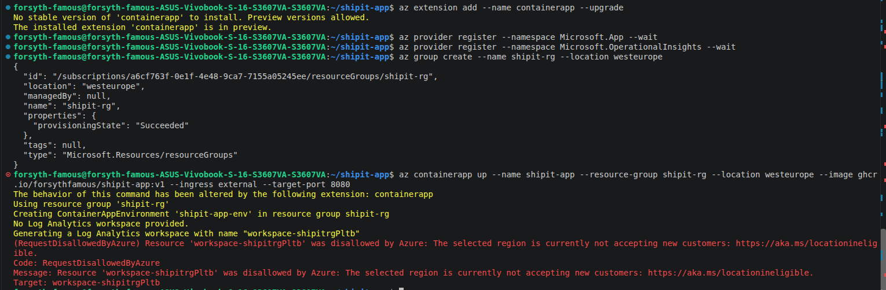

Checking the group showed no resources within it:

```bash
az resource list --resource-group shipit-rg --output table
```

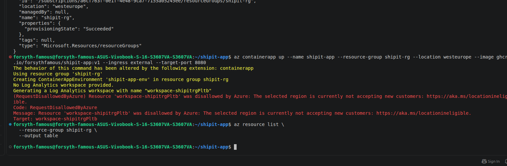

### Final deployment: Poland Central

The empty group was deleted and recreated in Poland Central:

```bash
az group delete --name shipit-rg --yes
az group create --name shipit-rg --location polandcentral
```

Then the deployment command was rerun with the new location:

```bash
az containerapp up \
  --name shipit-app \
  --resource-group shipit-rg \
  --location polandcentral \
  --image ghcr.io/forsythfamous/shipit-app:v1 \
  --ingress external \
  --target-port 8080
```

Azure reported:

```text
Container app created. Access your app at https://shipit-app.mangohill-66b09a85.polandcentral.azurecontainerapps.io/
Your container app shipit-app has been created and deployed! Congrats!
```

The deployment also generated a Log Analytics workspace successfully in Poland Central.

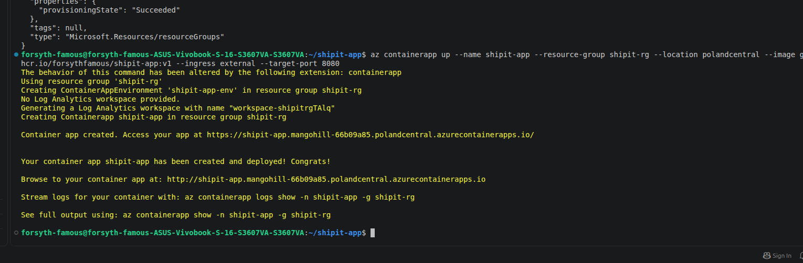

### Private GHCR image access

The initial GHCR package was **private**. Azure must have credentials/permissions to pull a private package (for example, Container Apps registry credentials stored as a secret). The provided terminal history verifies the deployment worked, **but does not show exactly how the initial private registry authentication was configured**. Do not assume private images can be pulled anonymously. Verify an existing app's registry settings before rotating credentials:

```bash
az containerapp registry list \
  --name shipit-app \
  --resource-group shipit-rg \
  --output table
```

This command lists configuration metadata; never print or commit registry passwords.

## 8. GitHub Actions CI/CD workflow

After the manually hosted version worked, the next goal was to eliminate manual rebuilds and Azure updates for each code change.

Create `.github/workflows/deploy.yml`:

```yaml
name: deploy

on:
  push:
    branches: [main]
  workflow_dispatch:

permissions:
  contents: read
  packages: write

jobs:
  deploy:
    runs-on: ubuntu-latest
    steps:
      - uses: actions/checkout@v4

      - name: Log in to GitHub Container Registry
        uses: docker/login-action@v3
        with:
          registry: ghcr.io
          username: ${{ github.actor }}
          password: ${{ secrets.GITHUB_TOKEN }}

      - name: Build and push the image
        run: |
          IMAGE=ghcr.io/${GITHUB_REPOSITORY_OWNER,,}/shipit-app:${GITHUB_SHA::7}
          docker build -t "$IMAGE" .
          docker push "$IMAGE"
          echo "IMAGE=$IMAGE" >> "$GITHUB_ENV"

      - name: Log in to Azure
        uses: azure/login@v2
        with:
          creds: ${{ secrets.AZURE_CREDENTIALS }}

      - name: Deploy to Azure Container Apps
        run: az containerapp update --name shipit-app --resource-group shipit-rg --image "$IMAGE"
```

> This is a faithful reconstruction of the **session's workflow structure**, with the intended workflow-level `permissions` block included exactly once. Before replacing a live workflow, compare it with the actual repository file. The script uses Bash lowercase expansion (`${GITHUB_REPOSITORY_OWNER,,}`) and a seven-character SHA (`${GITHUB_SHA::7}`), both supported by the normal Linux shell used here.

### Why this works

- **`on.push.branches: [main]`** triggers CI/CD for pushes to the main branch.
- **`workflow_dispatch`** allows manual runs.
- **`contents: read`** gives checkout read access to repository contents.
- **`packages: write`** requests GHCR publishing access for `GITHUB_TOKEN`; the repository must also have package access where required.
- **Commit SHA tagging** creates a traceable immutable-ish tag per commit, avoiding reliance on `latest`.
- **`GITHUB_ENV`** makes the built image name available to subsequent workflow steps.
- **`azure/login@v2`** authenticates using the Azure service principal's stored JSON.
- **`az containerapp update`** instructs Azure to use the newly pushed image, creating a new revision as appropriate.

The workflow builds the application **on GitHub-hosted infrastructure**. The developer no longer needs to rebuild and push each new version from the local machine.

### Demonstrating the change

The application heading was changed using:

```bash
sed -i.bak 's/Hello from Shipit Weekend!/Shipped automatically by GitHub Actions!/' app.py \
  && rm app.py.bak

git add .github/workflows/deploy.yml app.py
git commit -m "ci: deploy to Azure on every push"
git push
```

The commit shown in the screenshots was `901e82f` on `main`. The push itself succeeded, but initially the Actions run failed: a successful Git push is **not equivalent to a successful deployment**.

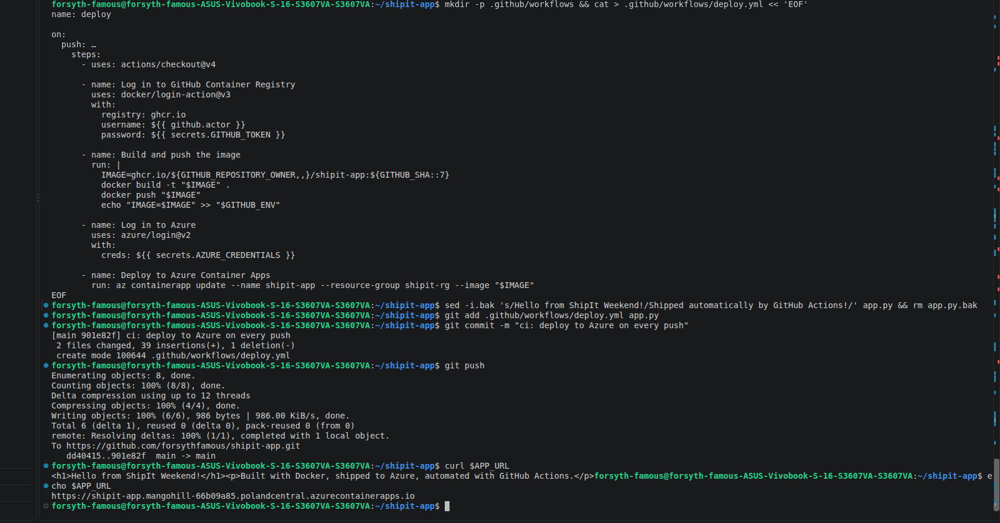

## 9. Azure authentication and GitHub secrets

### Service principal creation

The Azure identity was created using the following resource-group-scoped command (with `$SUB_ID` set to the subscription ID):

```bash
az ad sp create-for-rbac \
  --name shipit-github \
  --role contributor \
  --scopes /subscriptions/$SUB_ID/resourceGroups/shipit-rg \
  --json-auth
```

`--json-auth` formats the response for use with `azure/login`'s `creds:` input. The correct secret JSON structure is:

```json
{
  "clientId": "<service-principal-app-id>",
  "clientSecret": "<service-principal-client-secret>",
  "subscriptionId": "<azure-subscription-id>",
  "tenantId": "<azure-tenant-id>"
}
```

**Keep the double quotes in the actual JSON.** Do not include Markdown code fences, and do not wrap the entire JSON object in an additional quoted string. The secret is sensitive.

GitHub path: **Repository → Settings → Secrets and variables → Actions → New repository secret**.

```text
Secret name: AZURE_CREDENTIALS
Secret value: the complete --json-auth JSON object
```

The screenshot showed **no repository secrets**, explaining why `azure/login@v2` failed despite the service principal being created in Azure. Adding the JSON to GitHub was the missing bridge.

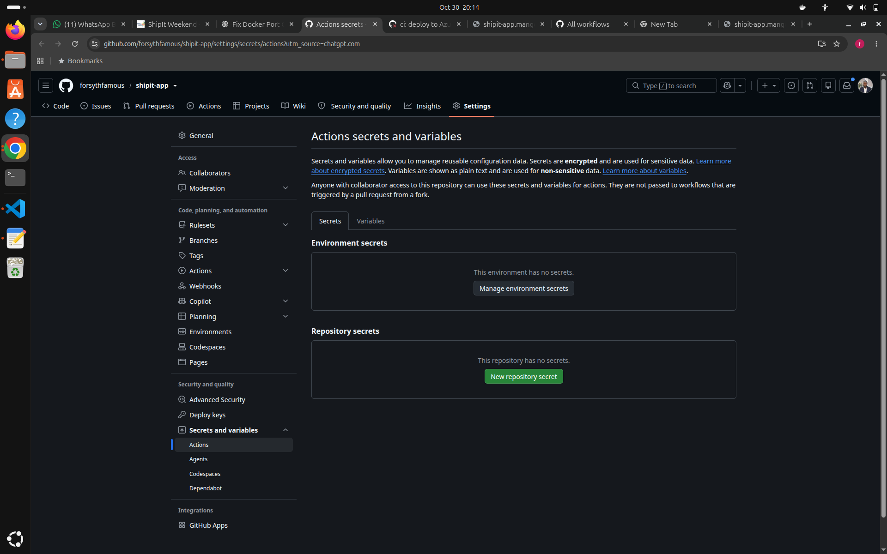

A role assignment on the Azure resource group is necessary for updates; storing the secret in GitHub is separately necessary for the workflow to **authenticate as that identity**.

> **Recommended later:** Replace the client secret with GitHub Actions **OpenID Connect (OIDC)** and Azure federated identity credentials. OIDC avoids keeping a long-lived cloud credential in a repository secret. That was not the implemented authentication method in this lab.

## 10. End-to-end verification

### Original application content

The first successful public web page displayed:

```text
Hello from Shipit Weekend!
Built with Docker, shipped to Azure, automated with GitHub Actions.
```


### Updated application content

After troubleshooting the automated workflow, the same public Azure endpoint displayed:

```text
Shipped automatically by GitHub Actions!
Built with Docker, shipped to Azure, automated with GitHub Actions.
```


This visible change is the decisive end-to-end test of the source-to-cloud workflow. It confirms the updated application was served publicly; it does **not** independently prove production-readiness or continuous availability.

### Useful verification commands

```bash
# Inspect resources
az resource list --resource-group shipit-rg --output table

# Check Container App deployment and hostname
az containerapp show \
  --name shipit-app \
  --resource-group shipit-rg \
  --query '{provisioning:properties.provisioningState,running:properties.runningStatus,fqdn:properties.configuration.ingress.fqdn}' \
  --output json

# Check recent logs
az containerapp logs show \
  --name shipit-app \
  --resource-group shipit-rg \
  --tail 50

# Confirm public HTTP response
curl -i https://shipit-app.mangohill-66b09a85.polandcentral.azurecontainerapps.io/
```

## 11. Troubleshooting diary: every issue encountered

The timeline below preserves the order of issues encountered on **October 30, 2026**, and distinguishes proven causes from likely causes.

### Issue 1 — `port is already allocated`

**Symptom:**

```text
Bind for 0.0.0.0:8080 failed: port is already allocated
```

**Investigation:** `docker ps` showed no running containers, but `sudo ss -ltnp 'sport = :8080'` revealed `docker-proxy` listeners.

**Cause confirmed:** The normal Docker CLI and `sudo docker` were pointed at **different Docker daemons**. A WordPress web container in the system Engine used host port 8080.

**Resolution:** Found the owner through `sudo docker ps -a` and stopped `my-wordpress-site-wordpress-1` when it was safe to interrupt that site. The alternative is to expose Shipit on host port 8081.

**Lesson:** Inspect the listener and all Docker contexts before killing processes.

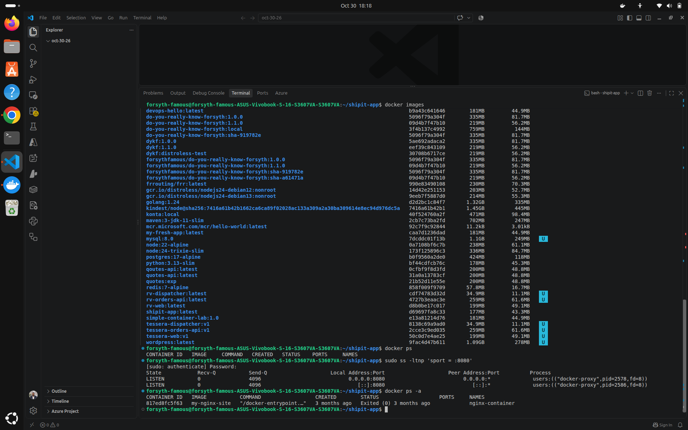

### Issue 2 — Docker restart did not release 8080

**Symptom:** `sudo systemctl restart docker` changed proxy PIDs, but `ss` still showed port 8080 occupied.

**Cause confirmed:** The system Docker service restarted the existing WordPress container, which reclaimed its published port.

**Resolution:** Stop the owning container or choose another host port; restarting the entire daemon is neither necessary nor sufficient.

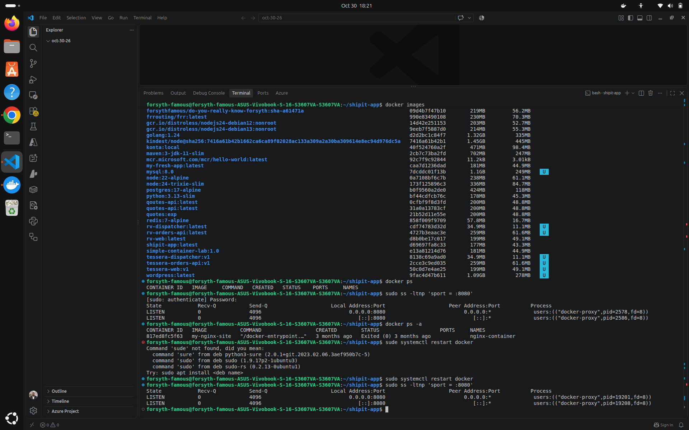

### Issue 3 — `pull access denied for shipit-app`

**Symptom:** After freeing the port, Docker said it could not find `shipit-app:latest` locally and failed to pull it from Docker Hub.

**Cause:** The active Docker daemon had no matching local image, despite an image having been visible in another context earlier.

**Resolution:** Check `docker context show` and `docker images`, then build/tag/pull in the intended daemon. The source transcript does not establish which image-transfer method was ultimately used at this exact step, so none is claimed here.


### Issue 4 — GHCR push timeout and `denied`

**Symptom:** First push timed out on a layer commit, retry returned `error from registry: denied`.

**Investigation:** Classic token had `write:packages`; GHCR package visibility was private; account role was Admin.

**Resolution:** A subsequent push completed with a manifest digest. The record does not conclusively identify whether refreshed login, retrying, or temporary registry/network conditions made the difference.

**Lesson:** A successful Docker login and uploaded layers don't guarantee a completed publish; verify the manifest digest and permissions separately.


### Issue 5 — Azure rejected new workspace in West Europe

**Symptom:** `RequestDisallowedByAzure` while creating the generated Log Analytics workspace; selected region reportedly not accepting new customers.

**Cause confirmed:** Azure regional eligibility/resource-provisioning restriction, not the Python image.

**Resolution:** Confirmed no resources in `shipit-rg`, deleted it, recreated in `polandcentral`, then reran `az containerapp up`. The deployment succeeded and Azure created the workspace there.


### Issue 6 — GitHub Actions GHCR permission failure

**Symptom:** First CI workflow failed during image push with:

```text
permission_denied: write_package
```

**Cause:** The `GITHUB_TOKEN` issued to the GitHub Actions workflow did not have effective write access to the existing GHCR package. The manual PAT and GitHub Actions token are different identities.

**Investigation:** The workflow **already contained** `permissions: contents: read` and `packages: write`; adding the block a second time was unnecessary and would create duplicate YAML keys.

**Resolution:** Configure the package's **Manage Actions access** so repository `forsythfamous/shipit-app` has Write access; re-run the workflow. The following run progressed past GHCR and failed later at Azure login, showing the registry step had been unblocked.

**Lesson:** `packages: write` is required but may not be sufficient for an existing private package. Package-to-repository access matters.

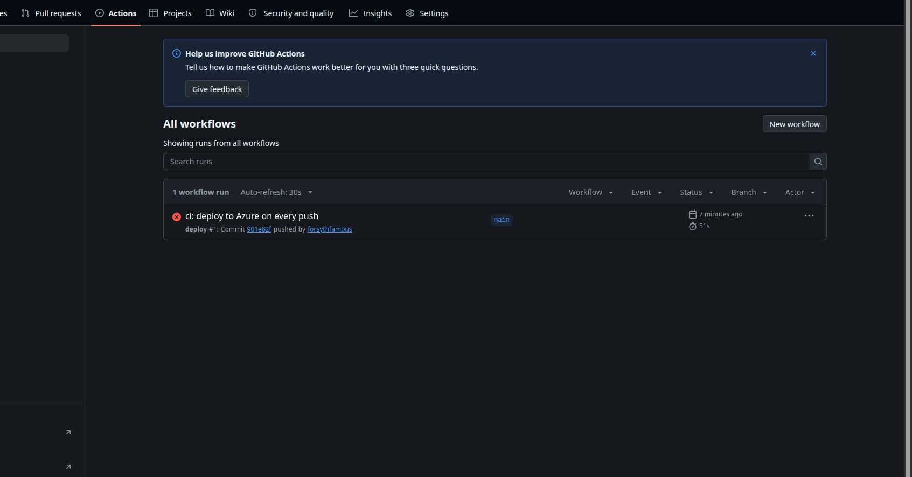
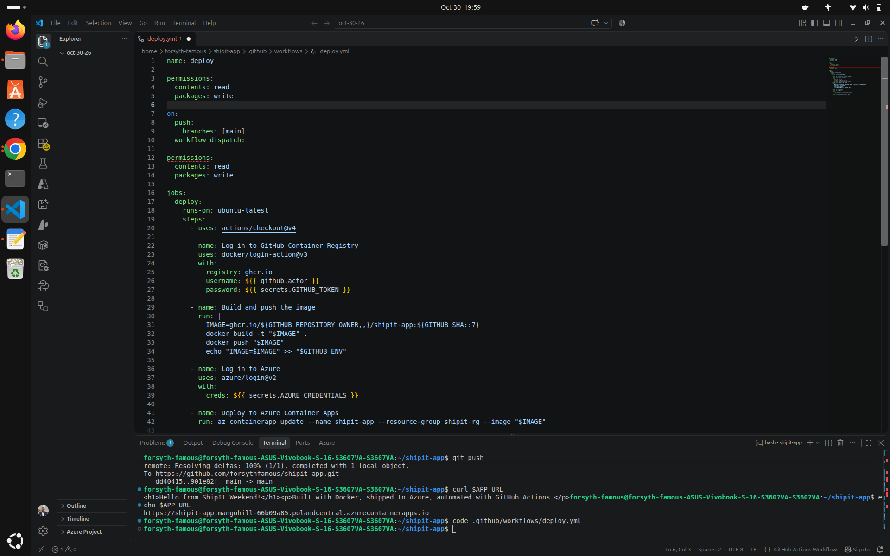

### Issue 7 — GitHub Actions failed to log in to Azure

**Symptom:**

```text
Login failed with Error: Using auth-type: SERVICE_PRINCIPAL.
Not all values are present. Ensure 'client-id' and 'tenant-id' are supplied.
```

**Cause confirmed:** The repository had **no Actions secrets**, so `secrets.AZURE_CREDENTIALS` supplied no service principal JSON to `azure/login@v2`.

**Resolution:** The resource-group-scoped service principal had already been created with `az ad sp create-for-rbac --json-auth`. Its credentials needed to be saved as the complete JSON object in a GitHub repository secret named **`AZURE_CREDENTIALS`**. The corrected pipeline subsequently delivered the updated web page.

**Lesson:** Creating an Azure identity does not automatically make it available to GitHub. The authentication configuration crosses two separate platforms.

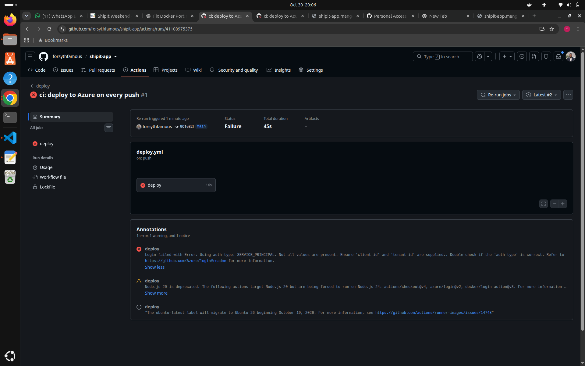


### Non-blocking warnings observed

GitHub Actions also showed notices regarding Node.js runtime migration for some actions and an upcoming `ubuntu-latest` runner image migration. These were **warnings**, not the error that caused the Azure login failure. Action versions should be maintained over time.

## 12. Key technical lessons

1. **Docker daemon and context are part of the environment.** `docker`, `sudo docker`, and Docker Desktop do not necessarily share containers, images, or ports.
2. **Host ports are exclusive across listeners.** Check the real owning process rather than assuming an empty `docker ps` implies a free port.
3. **Container image publishing has multiple stages.** Uploading layers differs from publishing the image manifest; the final digest matters.
4. **Registry identities differ between local CLI and CI.** A classic PAT with `write:packages` does not automatically authorize a workflow's `GITHUB_TOKEN`.
5. **Resource group location and workload region are distinct.** Both were set to Poland Central in the final environment for organizational clarity, not because Azure always requires it.
6. **Azure's regional/subscription eligibility matters.** A provider may be registered while a specific resource deployment still fails in a selected region.
7. **Secret creation is not secret distribution.** The service principal existed in Azure but `AZURE_CREDENTIALS` was absent in GitHub.
8. **Commit/push is not deploy.** Check the Actions job and, ultimately, the live endpoint.
9. **Clear evidence helps debugging.** Screenshots, terminal output, exit codes, and resource status let each failure be addressed without rebuilding everything.

## 13. Security, operations, and cost controls

### Security

- Keep the GHCR package private if public distribution is unnecessary.
- Configure least-privilege **Manage Actions access** for the repository that publishes images.
- Store credentials in GitHub Actions secrets; never in `deploy.yml`, `app.py`, shell history, or screenshots uploaded publicly.
- Use resource-group-scoped RBAC rather than subscription-wide Contributor where possible.
- Prefer OIDC federation to client-secret credentials for long-term CI/CD.
- Consider pinning third-party GitHub Actions to reviewed commit SHAs for higher-assurance workflows.
- Do not reveal client secrets in `az ad sp create-for-rbac` output, screenshots, or issue trackers.

### Operations

- Check the Azure Container App revision status and live FQDN after each deployment.
- Use commit-SHA tags so each release is traceable to source.
- Add health probes, resource limits, explicit revision/rollback procedures, automated tests, and deployment smoke checks before production use.
- Inspect diagnostics using Azure Container Apps logs and Log Analytics. Logging storage may incur charges.
- The example workflow deploys on every push to `main`; for a production service, consider branch protections and required review.

### Cost management

Azure Container Apps, logging, networking, and related resources may incur charges. When the lab is no longer needed:

```bash
# Review first
az resource list --resource-group shipit-rg --output table

# Destructive: removes the resource group and all of its resources
az group delete --name shipit-rg --yes
```

Do **not** run the delete command while the public endpoint is still needed. Deleting the resource group does not delete GitHub source code or packages, but it destroys the Azure deployment.

## 14. Improvements and next steps

Suggested priorities:

1. **Move Azure login to OIDC:** create an Entra federated credential restricted to this repository/branch, assign minimal RBAC, and switch the workflow to `azure/login@v2` with `client-id`, `tenant-id`, `subscription-id`, and `id-token: write` (instead of `creds`).
2. **Add tests before image publishing:** basic Python tests, linting, and a container smoke test.
3. **Add a post-deploy smoke test:** `curl --fail` against the Azure FQDN, with a predictable `/health` endpoint.
4. **Define deployment rollback:** capture the previous Container Apps revision and document rollback commands.
5. **Use a stricter image identity:** consider deploying by immutable digest rather than reusing mutable tags.
6. **Implement cost and security guardrails:** Azure Budget alerts, minimal replicas, monitoring retention, least privilege, and Dependabot.
7. **Optional: Infrastructure as Code:** model the resource group, Container Apps environment, Log Analytics, Container App, and role assignments with Terraform/Bicep.

These are **recommendations**, not features already implemented or verified in the session.

## 15. Screenshot evidence

Screenshots are stored under [`docs/screenshots/`](docs/screenshots/) and are referenced from the relevant sections above. They are supplied as project evidence; some contain the workstation username and GitHub/Azure resource identifiers. Review images before publishing the repo if you prefer to hide personal or account metadata.

| # | Evidence | File |
| --- | --- | --- |
| 01 | Port 8080 held by `docker-proxy` | [01-port-8080-docker-proxy.png](docs/screenshots/01-port-8080-docker-proxy.png) |
| 02 | Docker restart did not clear the port | [02-docker-restart-port-persisted.png](docs/screenshots/02-docker-restart-port-persisted.png) |
| 03 | Two Docker daemons; WordPress occupied 8080 | [03-two-docker-daemons-wordpress-conflict.png](docs/screenshots/03-two-docker-daemons-wordpress-conflict.png) |
| 04 | Port cleared, but image missing in current daemon | [04-port-cleared-image-not-found.png](docs/screenshots/04-port-cleared-image-not-found.png) |
| 05 | GHCR push timeout/denial | [05-ghcr-push-denied.png](docs/screenshots/05-ghcr-push-denied.png) |
| 06 | GHCR push completed with digest | [06-ghcr-push-success.png](docs/screenshots/06-ghcr-push-success.png) |
| 07 | Azure West Europe workspace restriction | [07-azure-westeurope-restriction.png](docs/screenshots/07-azure-westeurope-restriction.png) |
| 08 | Empty RG after failed West Europe deployment | [08-azure-resource-group-empty.png](docs/screenshots/08-azure-resource-group-empty.png) |
| 09 | Poland Central deployment completed | [09-azure-polandcentral-deployment-success.png](docs/screenshots/09-azure-polandcentral-deployment-success.png) |
| 10 | Original live website | [10-initial-live-site.png](docs/screenshots/10-initial-live-site.png) |
| 11 | Workflow, app change, commit and push | [11-github-actions-workflow-creation.png](docs/screenshots/11-github-actions-workflow-creation.png) |
| 12 | First failing Actions run | [12-first-github-actions-failure.png](docs/screenshots/12-first-github-actions-failure.png) |
| 13 | Generic Actions exit-code error | [13-github-actions-generic-error.png](docs/screenshots/13-github-actions-generic-error.png) |
| 14 | Existing `permissions` block in workflow | [14-workflow-permissions-already-present.png](docs/screenshots/14-workflow-permissions-already-present.png) |
| 15 | Azure service principal login error | [15-azure-login-missing-credentials.png](docs/screenshots/15-azure-login-missing-credentials.png) |
| 16 | No GitHub repository secrets configured | [16-github-repository-secrets-empty.png](docs/screenshots/16-github-repository-secrets-empty.png) |
| 17 | Updated production website | [17-final-live-site.png](docs/screenshots/17-final-live-site.png) |

## 16. Useful command reference

```bash
# Docker inspection
docker context ls
docker context show
docker ps -a
sudo docker ps -a
sudo ss -ltnp 'sport = :8080'

# Local Docker build/run
docker build -t shipit-app:latest .
docker run -d --rm --name shipit -p 8081:8080 shipit-app:latest

# GHCR publish
docker login ghcr.io -u forsythfamous
docker build -t ghcr.io/forsythfamous/shipit-app:v1 .
docker push ghcr.io/forsythfamous/shipit-app:v1

# Azure context and resources
az account show --output table
az group show --name shipit-rg --output table
az resource list --resource-group shipit-rg --output table
az containerapp show -n shipit-app -g shipit-rg --output table
az containerapp logs show -n shipit-app -g shipit-rg --tail 50

# Verify the live deployment
curl -i https://shipit-app.mangohill-66b09a85.polandcentral.azurecontainerapps.io/

# Submit a new source change
git status
git add app.py
git commit -m "feat: update application content"
git push
```

---

## Conclusion

Shipit Weekend started as a minimal Python page in a Docker container and finished as a publicly accessible **Azure Container App** in **Poland Central**, with a GitHub Actions pipeline updating the deployed application from a source-code push.

The important achievement was not only reaching a live URL. The project also demonstrated a realistic debugging sequence across the local runtime, container image storage, Azure provisioning, CI package permissions, and Azure service principal authentication. The final heading change on the live site provided visible proof that the delivery chain was operational.

**Built with Docker. Published through GHCR. Automated with GitHub Actions. Shipped to Azure.**
